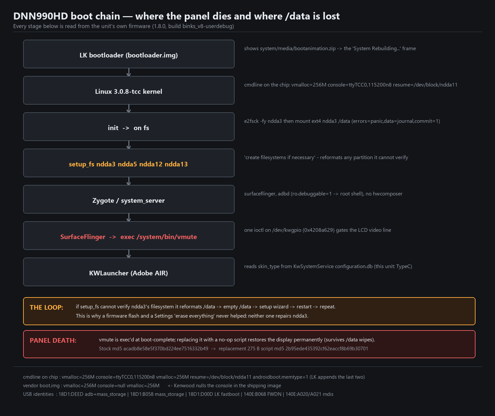
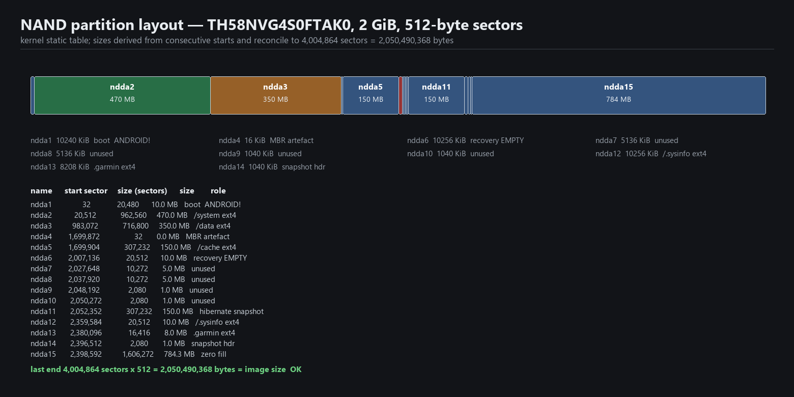
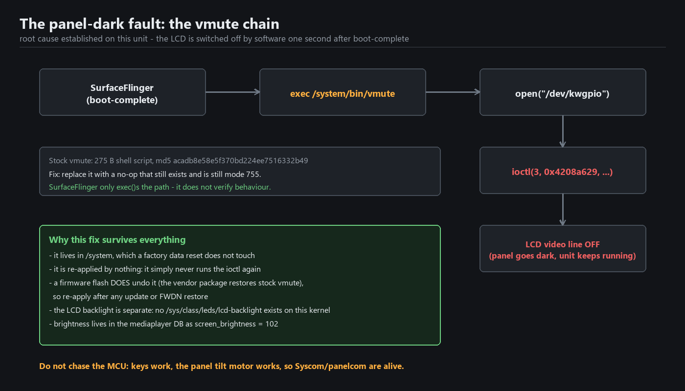
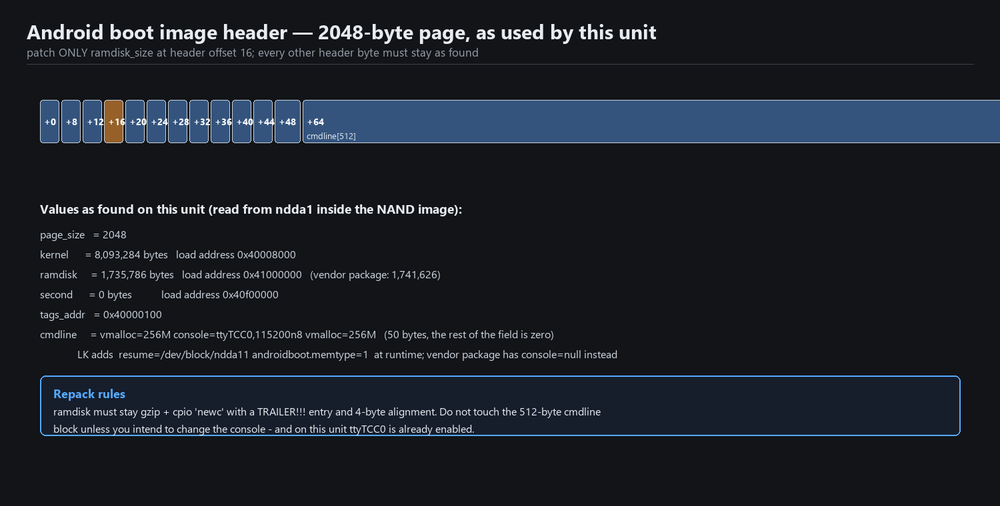
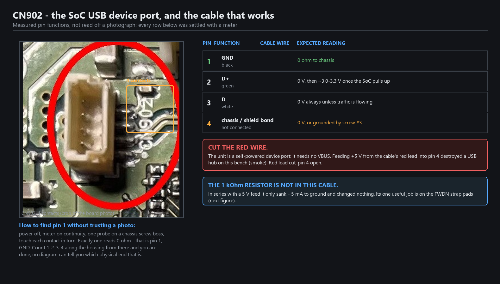
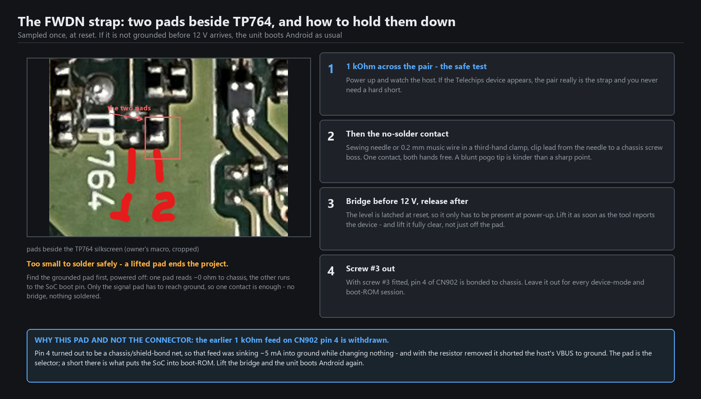
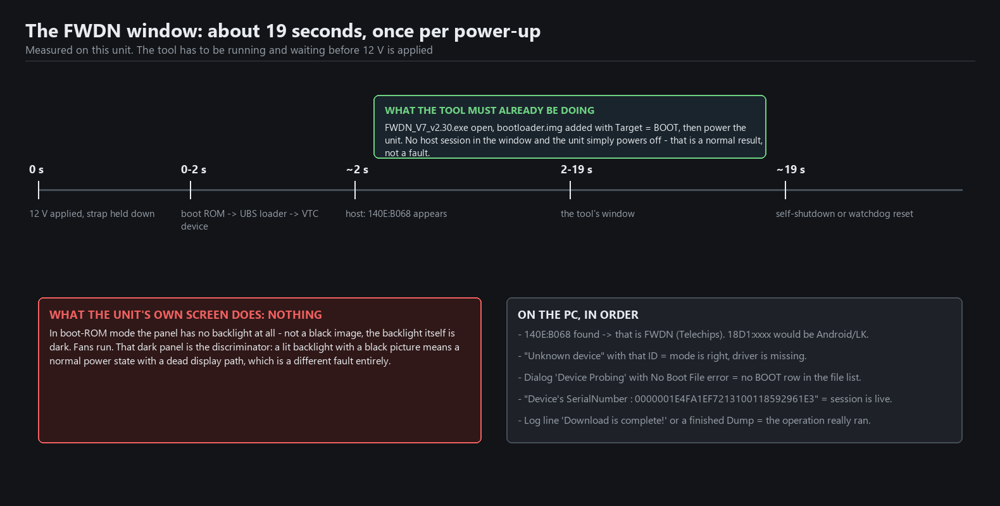

# Kenwood DNN990HD — repair and reverse-engineering notes

Documentation of bringing a 2013 Kenwood DNN990HD head unit (Telechips TCC8801, Android 4.0.4)
back from a permanently black screen, plus the low-level notes needed to keep it alive: the real
partition map, the boot image layout, the FWDN recovery-container format, and the `/data`
persistence fault that is still open.

Every number, address and command here was read out of the unit itself or measured on it. Where
something is a hypothesis it says so.

**No Kenwood firmware, APK, system image or NAND dump is redistributed in this repository** — only
instructions, our own scripts, and our own measurements. See [Legal](#legal).

---

## Status

| Area | State |
|---|---|
| Display | **Fixed** — LCD was being muted in software, not dead. See [docs/02](docs/02-panel-dark-fix.md) |
| Root shell | **Working** — `adbd` runs as root on this build (`ro.debuggable=1`) |
| NAND backup | **Taken, verified, archived in 3 places** — see [docs/03](docs/03-nand-backup-and-restore.md) |
| Firmware | **1.8.0 = the last release ever made** for this model; the package is byte-identical to what is installed |
| Front panel keys | Working (MCU → `KWApplication`, not Linux input) |
| EJECT | Inert **by design** — no disc mechanism fitted; the key does emit events |
| `/data` persistence | **Open** — unit lands in initial setup on every boot. See [docs/07](docs/07-data-persistence-and-bootloop.md) |
| FWDN (boot-ROM) mode | **Working** — entry procedure, driver and tool in [docs/09](docs/09-fwdn-mode.md); chip dump through it in [docs/10](docs/10-nand-backup-with-fwdn.md) |
| Garmin navigation | **Unrecoverable without the original SD card** — no map data exists on NAND or in the firmware package |

---

## Read this before you touch anything

1. **Back up the whole NAND before the first write.** `dd if=/dev/block/ndda of=/mnt/usb/nand.img`.
   Everything else in this repo assumes you have that image.
2. **Never restore that whole image back.** It contains the MBR that breaks LK's boot path on this
   unit. Restore partitions individually. ([why](docs/03-nand-backup-and-restore.md#never-restore-the-whole-image))
3. **Do not press "Erase everything"** in Settings. On this unit it dead-ends: there is no `misc`
   partition, no bootloader control block, and `ndda6` (recovery) is pure zero fill, so the wipe can
   never complete. It only risks making things worse.
4. **Only one port can write**: CN902, the SoC USB device port on the main board. It is internal —
   reachable with the cover off, not with the unit assembled. FWDN (`140E:B068`) and `adb` both use it.
5. **FWDN mode needs the boot-strap pads shorted at power-up** (tweezers or a needle work; 1 kΩ first
   as a safe test). On this board the pads sit *under the heatsink*. Full procedure in
   [docs/09](docs/09-fwdn-mode.md) — and **never feed 5 V into CN902 pin 4**, it is a chassis bond
   ([docs/08](docs/08-cn902-port-and-cable.md)).
6. **A firmware update restores the stock `vmute`** and re-kills the panel. Re-apply
   [the patch](patches/vmute) afterwards.

---

## What actually went wrong

Three separate faults got mistaken for one dead unit:

1. **Black screen, unit fully alive.** The kernel module `panelcom` and the LCD are fine; after
   boot-complete SurfaceFlinger `exec`s `/system/bin/vmute`, which issues one `ioctl` on
   `/dev/kwgpio` and gates the LCD video line off. Replacing that 275-byte script with a no-op
   brings the display back permanently — and the fix lives in `/system`, so a factory data reset
   does not undo it.

2. **"System Rebuilding…" on every boot is not a fault report.** It is a *boot animation frame* —
   `system/media/bootanimation.zip` contains exactly one image, `ani1/message1_888.png`, and the
   whole of `desc.txt` is `p 0 0 ani1`. That screen is what this build shows while Android starts,
   always. The actual symptom is only what comes after it.

3. **The unit lands in initial setup every boot** because `/data` does not survive a reboot. The
   prime suspect is the ramdisk service `setup_fs ndda3 ndda5 ndda12 ndda13` — *"create filesystems
   if necessary"* — which reformats any partition whose filesystem it cannot verify. Diagnosis
   procedure in [docs/07](docs/07-data-persistence-and-bootloop.md).



---

## The five findings worth knowing

- **The console is already enabled in software.** The running kernel's command line carries
  `console=ttyTCC0,115200n8`, and `init.rc` already has `service console /system/bin/sh`. The
  `console=null` seen in the *vendor package* is irrelevant to what the chip is running. UART work
  on this model is purely physical — no kernel patching required.
- **`factory.fstab` is a decoy.** It describes yaffs2. The real mounts are ext4, done by
  `init.tcc8800.fs.rc`, which runs `e2fsck -fy` and then mounts `ndda2/3/5/12/13` with
  `errors=panic,data=journal,commit=1`.
- **The panel and keys are kernel-space.** `syscom.ko` and `panelcom.ko` are in the ramdisk.
  `kwgpio.ko`, `kwram.ko`, `kwtmcdec.ko` too. So "the screen is dark" never means "Android is dead".
- **The partition table in the MBR is wrong** — it describes 3 of 15 partitions. The authority is
  the kernel's static table, recoverable from `/sys/class/block/nddaN/start` and `size`.
- **`adb exec-out` does not exist on this adbd** (Android 4.0), `rm` has no `-f`, there is no
  `printf`, and no `cp`. `cat src > dst` is the copy.

---

## Repository map

```
docs/01-unit-and-access.md          hardware ID, USB identities, how to get a root shell
docs/02-panel-dark-fix.md           the black-screen fault and the permanent fix
docs/03-nand-backup-and-restore.md  backup, verification, per-partition restore
docs/04-vendor-update-attempt.md    running the official 1.8.0 updater (what it does and doesn't fix)
docs/05-firmware-analysis.md        full teardown of update.kw and the boot image (phase 1 report)
docs/06-partitions-and-boot-image.md
docs/07-data-persistence-and-bootloop.md
docs/08-cn902-port-and-cable.md       the one port that matters: pinout, the cable, the 1 kOhm story
docs/09-fwdn-mode.md                  driver, tool, strap pads, the 19-second boot-ROM window
docs/10-nand-backup-with-fwdn.md      reading the chip through FWDN, and why never to write with it
docs/11-documents-and-manuals.md      the PDFs worth having (part numbers + why they are not shipped)
patches/vmute                         the 275-byte replacement script
tools/                                Windows .bat helpers + the Python figure/preview generators
tools/vendor/                         Telechips FWDN tool + VTC USB driver (checksummed) and the .fai format
evidence/                             framebuffer captures and tool screenshots from the unit
images/                               annotated diagrams and photo crops (regenerate with tools/make_figures*.py)
```

| Figure | What it shows |
|---|---|
|  | boot chain, where `/data` is lost, where the panel dies |
|  | the real 15-partition NAND map, reconciled to the image size |
|  | the `vmute` → `/dev/kwgpio` chain |
|  | Android boot header, byte offsets, repack rules |
|  | CN902 pin functions, the cable wire map, why the red lead is cut |
|  | the FWDN strap pads and the four rules for holding them down |
|  | the ~19 s boot-ROM window, and what each side should be showing |

---

## Unit under test

| | |
|---|---|
| Model | Kenwood DNN990HD (Excelon, 2013) |
| SoC | Telechips TCC8801 |
| OS | Android 4.0.4, build `binks_v8-userdebug 4.0.4 IMM76D eng.root.20181003.133037 test-keys` |
| Kernel | `Linux 3.0.8-tcc #3 PREEMPT Wed Oct 3 18:03:44 JST 2018`, gcc 4.4.3 |
| NAND | `TH58NVG4S0FTAK0`, 2 GiB, TSOP-48 — 4,004,864 × 512 B sectors |
| RAM | 802,096 kB visible |
| Display | CPT `CLAA069LA0ACW`, 800×480, driven by `panelcom` over SPI |
| Firmware | 1.8.0 — the last release; the vendor package matches the installed `/system` byte for byte |

---

## Legal

The documentation, scripts and diagrams here are provided as-is, with no warranty. Flashing,
formatting or otherwise writing to this hardware can destroy it permanently.

Kenwood's firmware (`update.kw`), the Android system images, the APKs and the NAND dumps are
Kenwood's and its licensors' property (including Garmin's navigation data). They are deliberately
**not** included, and you should not upload them to a public repository either. Everything you need
to reproduce this work is either generated by the scripts in `tools/` or extracted from hardware
you own.
