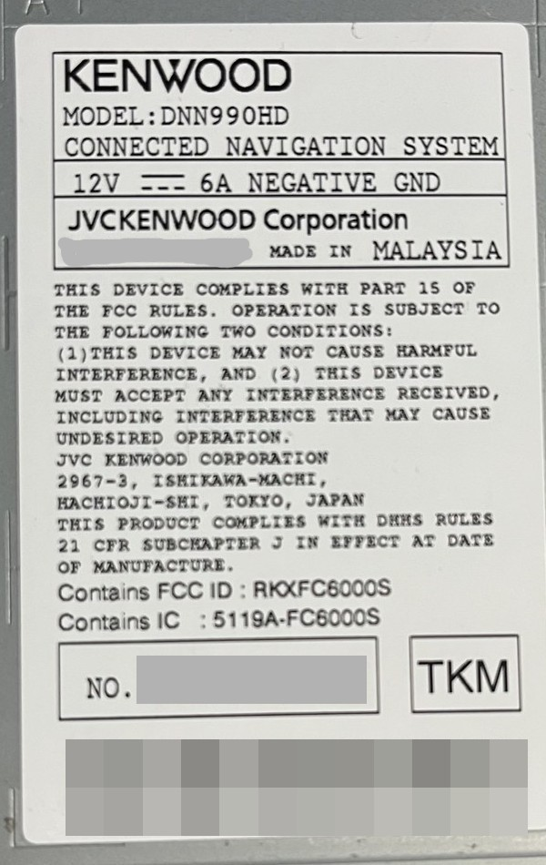
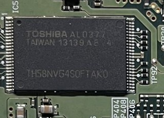
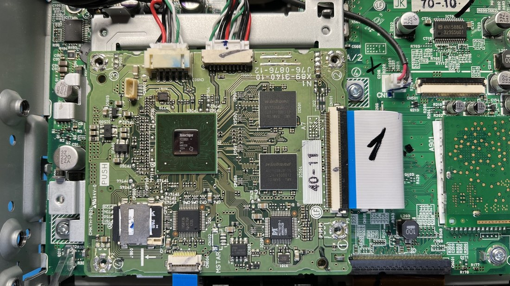
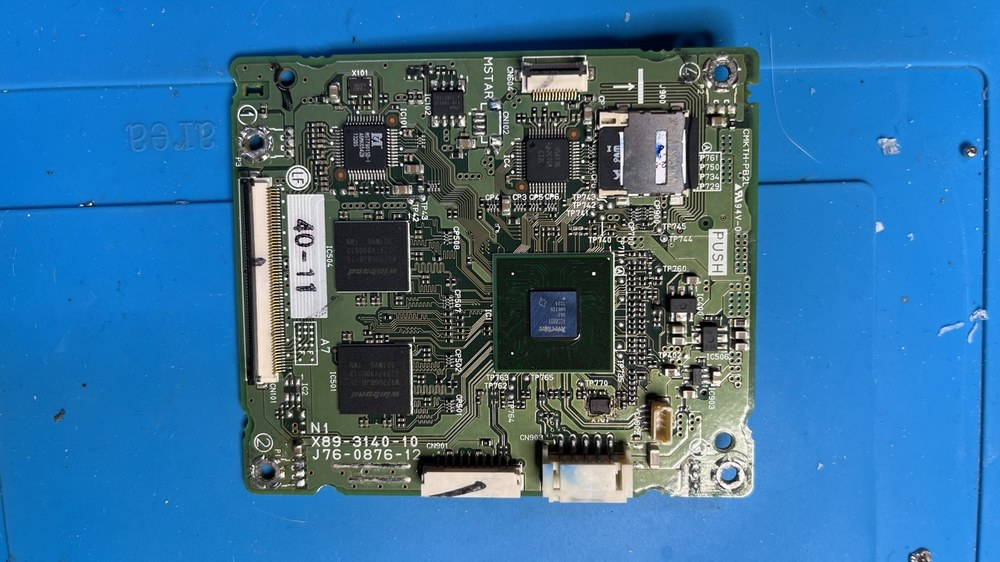

# 01 — The unit and how to get a shell on it

## Identification

Read from the running device:

```
ro.build.display.id = binks_v8-userdebug 4.0.4 IMM76D eng.root.20181003.133037 test-keys
ro.build.version.release = 4.0.4
Linux version 3.0.8-tcc #3 PREEMPT Wed Oct 3 18:03:44 JST 2018   (gcc 4.4.3)
MemTotal: 802096 kB
ro.QB.enable = 0
persist.sys.usb.config = mass_storage,adb
ro.debuggable = 1
ro.secure = 1
```

`ro.debuggable=1` with a `userdebug` build is why a **root** shell is available over adb without
unlocking anything. That is a property of the engineering build that shipped on this unit, not
something that was done to it.

Build date 2018-10-03, build host `Prominence` — this is a late engineering build for a 2013
product, and it is firmware **1.8.0**, the last release Kenwood ever made for the DNN990HD.



*The rear label: `DNN990HD`, `12 V 6 A NEGATIVE GND`, part number `Y39-6670-10`, FCC ID
`RIXFC6000S`. The serial number and the barcode under it are masked here — on your own unit the same
number is what `configuration.db` reports as `serial`, which is how a unit gets tied to the firmware
read out of it. Keep yours to yourself as well; it is enough to identify a radio.*



*The memory itself: `TH58NVG4S0FTAK0`, 2 GB SLC NAND in TSOP-48, on the processor module that carries
the SoC and its DDR. If your board does not carry this part, identify what it does carry before
following [docs/10](10-nand-backup-with-fwdn.md) — a different memory type means a different backup
route.*

## USB identities

From `init.tcc8800.usb.rc` in the ramdisk:

| Configuration | VID:PID | Meaning |
|---|---|---|
| `adb` | `18D1:D00D` | adb only |
| `mass_storage` | `18D1:B058` | the unit's storage exposed as a disk |
| `mass_storage,adb` | `18D1:DEED` | **default** — both at once |
| `rndis` | `140E:A020` | USB networking |
| `rndis,adb` | `140E:A021` | USB networking + adb |
| *(bootloader)* | `18D1:D00D` | LK fastboot — shows a black/grey panel; normal |
| *(boot ROM / FWDN)* | `140E:B068` | FWDN download mode |

## The only port that matters: CN902

CN902 is the **SoC USB device port** on the main board. It is *not* a UART header (pin 4 is ID and
shorts against the cable shield; wiring a serial adapter there does nothing useful).

- It carries both `adb` and FWDN.
- It is **internal**: reachable with the top cover off, not with the unit assembled in the dash.
- Every write path in these docs goes through it.

There is a second, separate header (CN102) that carries a real UART — `ttyTCC0`. It was probed and
is a **dead end for practical work**: it is alive only for ~65 ms during boot ROM + LK, before the
kernel, and the stop-bit validity measured 41–47.9 %, i.e. the pad probed was almost certainly the
Bluetooth UART (`ttyTCC1`), not the console. Kernel console output is available on `ttyTCC3` = GPS
and `ttyTCC1` = Bluetooth by configuration; nothing on this board exposes `ttyTCC0` as a pad.

## Getting the shell

With CN902 connected to a Windows PC and the unit powered:

```
C:\fwdn\platform-tools\adb.exe devices
# <serial>   device
```

The helpers in `tools/` are double-click wrappers around that:

| File | Does |
|---|---|
| `shell.bat` | opens an interactive root shell |
| `logs.bat` | pulls a full `logcat -b all` + `dmesg` to `C:\fwdn\probe\` |
| `data_health.bat` | the `/data` persistence probe — see [docs/07](07-data-persistence-and-bootloop.md) |
| `after_reset.bat` | re-disables the stock launcher, re-enables `com.jvckenwood.kwlauncher` and `jp.co.kenwood.multimediaplayer`, reboots |

Keep `adb.exe` together with `AdbWinApi.dll` and `AdbWinUsbApi.dll` — it will not run without them.

## Shell quirks on Android 4.0 / this build

These cost real time; they are not typos:

- **`adb exec-out` does not exist.** Use `adb shell "cmd > /sdcard/out"` then `adb pull`.
- **`rm` is BusyBox-style and has no `-f`.** `rm -f` fails.
- **No `printf`.** Use `echo`.
- **No `cp`.** Use `cat src > dst`.
- **`/system` is read-only by default**: `mount -o remount,rw /dev/block/ndda2 /system`.
- **`screencap` captures only the GL framebuffer** — there is no hwcomposer on this build, so any
  screen drawn by other means is not in the capture. (It is still exactly how the
  `evidence/*.png` files here were produced.)
- **`input keyevent` does nothing to KWLauncher.** Only `sendevent` multi-touch-A taps reach it.
- **`getevent` shows nothing for the front-panel keys** — those go MCU → `KWApplication`, not through
  Linux input. What does work is `adb logcat | grep OSC`:
  `I/OSC ( 1436): [[[ KeyPressEvent ]]]KeyID = 2055, KeyKind = 2, nowSceneID_=-1`

## Windows-specific traps

- **Windows latches the USB port off** after the device drops and re-enumerates. `adb devices` stays
  empty no matter what you restart. Move the cable to a **different physical port**.
- mDNS caching can hide the unit's network presence: `ipconfig /flushdns`.
- The unit draws ~1.88 A at 12 V (≈22 W) during boot; it needs a supply that actually holds that.

## What is inside the container



*The processor module in place, cover and shield frame off. `X89-3140-10` / `J76-0876-12` across the
module, the Telechips SoC at its centre with its two DDR2 devices beside it, the wide `40-11` flex on
the right, `PUSH` and the microSD cage at the left edge. The PCB at the right of the frame (`70-10`,
`CN101`, AN15886A) is a separate board. The pen marks on the flex and the frame are the previous
owner's, not Kenwood's.*



*The same module off the board: `X89-3140-10` / `J76-0876-12`, `MSTAR` silkscreen, the Telechips SoC in
the middle, two Winbond DDR2 devices (`IC502`, `IC503`), the `40-11` edge connector on the left, and
the microSD cage marked `PUSH` at the top right.*

The rest of this page is what runs on it:

- `syscom.ko` / `panelcom.ko` — front panel MCU link and the LCD, **in kernel space**.
- `kwgpio.ko`, `kwram.ko`, `kwtmcdec.ko` — GPIO access (used by `vmute`), RAM disk helpers, TMC decoder.
- `com.jvckenwood.kwsystemservice` — holds `configuration.db` with `system_model`, `serial`,
  `product` and `skin_type`.
- `KWLauncher.apk` — an **Adobe AIR** application, not a normal Android launcher (see
  [docs/05](05-firmware-analysis.md)).
- `system/lib/libNaviCore.so` (35.4 MB) — the Garmin navigation engine.
