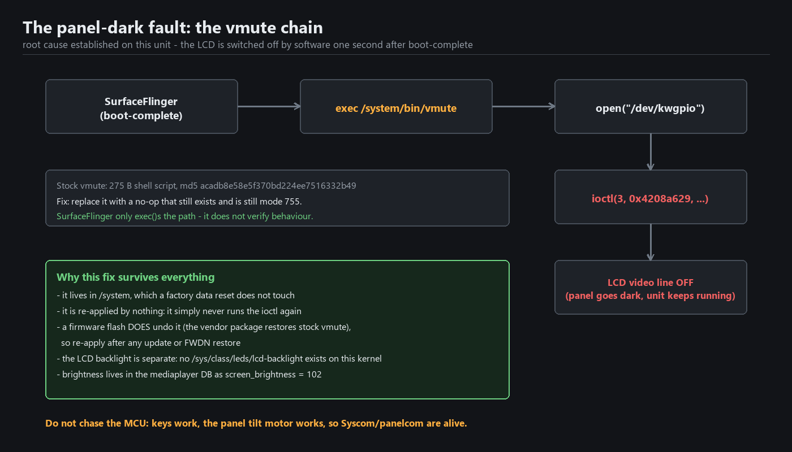

# 02 — The black screen, and the permanent fix

## Symptom

Power on: the Kenwood logo appears, then the panel goes **black** — permanently. The unit is fully
alive the whole time: it boots Android, the front-panel keys work, audio works, the tilt motor works,
and `adb` is reachable throughout. Touching the screen produces responses (you can hear them) with
nothing visible.

## Root cause

The LCD is being switched off by software, about a second after boot-complete.

```
SurfaceFlinger (boot-complete)
    -> exec /system/bin/vmute
        -> open("/dev/kwgpio")
            -> ioctl(3, 0x4208a629, ...)     <- LCD video line gated OFF
```



`vmute` is a **275-byte shell script**, md5 `acadb8e58e5f370bd224ee7516332b49`. SurfaceFlinger simply
`exec`s the path after "Boot is finished"; it does not check what the script does or whether it did
anything.

This is not a backlight fault: this kernel exposes no `/sys/class/leds/lcd-backlight` at all, and
brightness is a value (`screen_brightness = 102`) in the media player's database, applied by
`panelcom` over SPI. It is not an MCU fault either — the keys and the tilt motor answer, so the MCU
and `syscom` are both healthy.

## The fix

Replace the script with a no-op of the same name, still mode 0755. That is the whole patch
([`patches/vmute`](../patches/vmute), 275 bytes, md5 `2b95ede435392cf62eaccf8b69b30701`).

```sh
adb shell
mount -o remount,rw /dev/block/ndda2 /system
cat /system/bin/vmute > /data/local/tmp/vmute.orig     # keep the original
cat /sdcard/vmute > /system/bin/vmute                  # push the no-op first: adb push vmute /sdcard/
chmod 755 /system/bin/vmute
sync
mount -o remount,ro /dev/block/ndda2 /system
reboot
```

The panel now stays on from boot to shutdown.

## Why this fix behaves the way it does

- **It survives a factory data reset.** It lives in `/system`, which the reset does not touch. It
  survived the `/data` wipe that produced this unit's current boot loop.
- **A firmware update undoes it.** The vendor package restores the stock `vmute`. So does a full
  FWDN restore. Re-apply the patch after either.
- **It is reversible.** The original is preserved at `/data/local/tmp/vmute.orig`
  (md5 `acadb8e58e5f370bd224ee7516332b49`).
- **It changes nothing else.** No kernel, no ramdisk, no APK, no signature. If you ever want the old
  behaviour back, drop the original file in place and reboot.

## What not to try

- **Don't chase the MCU or the backlight.** Both were proven healthy before the fix was found.
- **Don't patch the kernel or ramdisk for this.** The chain is entirely in `/system`.
- **Don't repack any Kenwood APK.** They share signature-level permissions with each other; a
  repacked APK loses that signature and the `com.jvckenwood.*` services stop talking to each other.
- **Don't believe `screencap`** when diagnosing a dark panel: it reads the GL framebuffer only and
  will happily capture a picture of a screen nobody can see.
