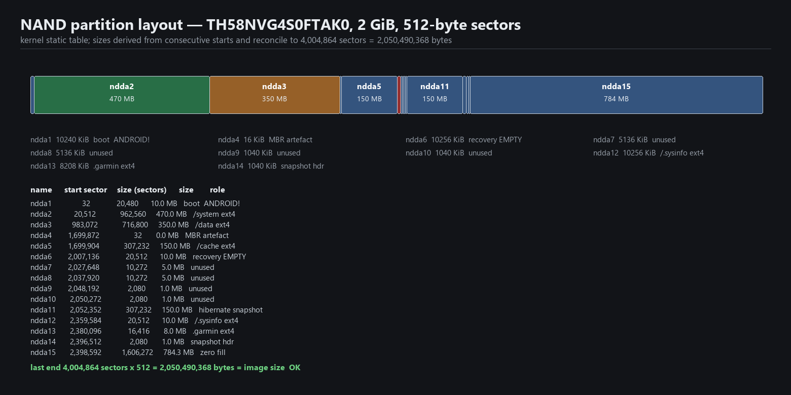
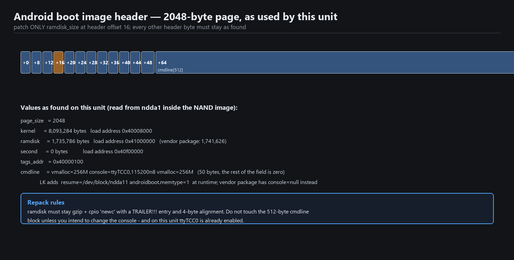

# 06 — The real partition map and the boot image

## The partition table

The MBR in `ndda` describes three partitions. The kernel's static table describes fifteen, and that
is the one that matters. Recovered from `/sys/class/block/nddaN/{start,size}` and cross-checked
against the image size:



| Name | Start sector | Sectors | Size | Contents |
|---|---|---|---|---|
| `ndda1` | 32 | 20,480 | 10.0 MB | boot — Android boot image (`ANDROID!`) |
| `ndda2` | 20,512 | 962,560 | 470.0 MB | `/system`, ext4 |
| `ndda3` | 983,072 | 716,800 | 350.0 MB | `/data`, ext4 |
| `ndda4` | 1,699,872 | 32 | 16 KiB | MBR artefact, no filesystem |
| `ndda5` | 1,699,904 | 307,232 | 150.0 MB | `/cache`, ext4 |
| `ndda6` | 2,007,136 | 20,512 | 10.0 MB | recovery — **pure zero fill** |
| `ndda7` | 2,027,648 | 10,272 | 5.0 MB | zero |
| `ndda8` | 2,037,920 | 10,272 | 5.0 MB | zero |
| `ndda9` | 2,048,192 | 2,080 | 1.0 MB | zero |
| `ndda10` | 2,050,272 | 2,080 | 1.0 MB | zero |
| `ndda11` | 2,052,352 | 307,232 | 150.0 MB | hibernate snapshot (`resume=/dev/block/ndda11`) |
| `ndda12` | 2,359,584 | 20,512 | 10.0 MB | `/.sysinfo`, ext4 |
| `ndda13` | 2,380,096 | 16,416 | 8.0 MB | `/.garmin`, ext4 |
| `ndda14` | 2,396,512 | 2,080 | 1.0 MB | zero |
| `ndda15` | 2,398,592 | 1,606,272 | 784.3 MB | zero fill |

Last end = 4,004,864 sectors × 512 = **2,050,490,368 bytes**, exactly the image size. If your numbers
do not reconcile like that, the table is wrong — recompute each row as *next start − start* rather
than trusting any single source. (Partition sizes are usually quoted in KiB in Android headers; here
everything is in 512-byte sectors, which is what `dd`, `/sys` and FWDN all use.)

### There is no `misc` partition

There is no bootloader control block anywhere in the image — `ndda7`–`ndda10` and `ndda14` are zero,
and none of them contains `boot-recovery`, `--wipe_data` or any other BCB string. LK keeps the boot
mode in its own storage:

```
##########bootmode = RESET
##########snapshot partition doesn't exist
ERROR : No Recvoery Partition Found!!
cmd_erase_emmc
Input 0xFF Data to NAND Partition
```

with modes `UPDAT`, `WAKE`, `RESET`, `FWDN`. This is why there is no *recovery* to boot and why the
"recovery" partition being zero fill does not stop the unit from running.

## The boot image



Header fields as read from `ndda1` inside the NAND image:

| Field | Value |
|---|---|
| magic | `ANDROID!` |
| page_size | 2048 |
| kernel_size | 8,093,284 |
| kernel_addr | `0x40008000` |
| ramdisk_size | **1,735,786** (vendor package: 1,741,626) |
| ramdisk_addr | `0x41000000` |
| second_size | 0 (`0x40f00000`) |
| tags_addr | `0x40000100` |
| cmdline | `vmalloc=256M console=ttyTCC0,115200n8 vmalloc=256M` (exactly 50 bytes; the remaining 462 bytes of the field are zero) |

The running kernel's `/proc/cmdline` is longer than the header field: LK appends
`resume=/dev/block/ndda11 androidboot.memtype=1` at runtime. Do not go looking for those bytes in the
boot image — they are not there.

Note the difference against the vendor package, whose cmdline is
`vmalloc=256M console=null vmalloc=256M`: the shipping image nulls the console. The chip is running
the one with `console=ttyTCC0,115200n8`, so a serial console is already configured in software —
patching for it is pointless.

### Repack rules, if you must

- Only `ramdisk_size` (offset 16) ever changes. Every other header byte stays as found.
- The ramdisk must stay gzip + cpio `newc`, terminated with a `TRAILER!!!` entry, and 4-byte aligned.
- The payload starts at the next 2048-byte page boundary after the header page.
- Do not touch the 512-byte cmdline block unless you intend to change the console — and on this unit
  you don't.

## Ramdisk contents worth knowing

`init.rc` already contains `service console /system/bin/sh`, and the mount logic is in
`init.tcc8800.fs.rc` (not `factory.fstab`, which is a yaffs2 decoy):

```
on fs
    mount ext4 /dev/block/ndda2 /system wait ro
    exec /system/bin/logwrapper /system/bin/e2fsck -fy /dev/block/ndda3
    mount ext4 /dev/block/ndda3 /data wait noatime nosuid nodev nomblk_io_submit,errors=panic,data=journal,commit=1
    ...
service setup_fs /system/bin/setup_fs ndda3 ndda5 ndda12 ndda13
    class core
    oneshot
```

`errors=panic` is why a *live* read error on `/data` reboots or hangs the unit instantly rather than
logging quietly — and why the current fault is almost certainly in the verify/format path rather than
in normal I/O. See [docs/07](07-data-persistence-and-bootloop.md).
