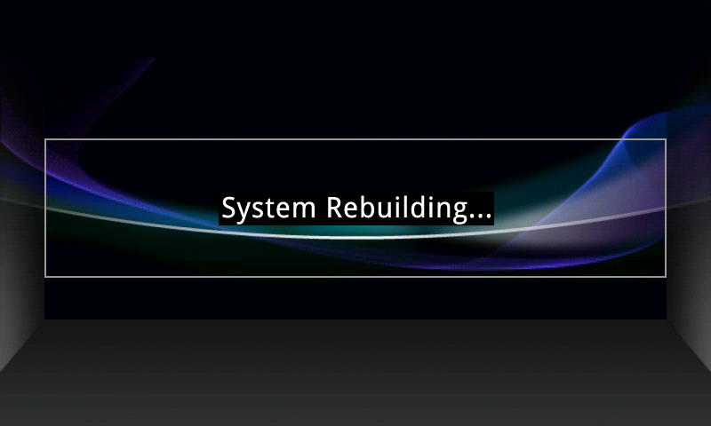

# 07 — "System Rebuilding" on every boot: what it is and how to diagnose it

## First, a correction

The screen that says **System Rebuilding…** is not a repair in progress and not an error report. It
is a **boot animation frame**, and this build shows it on *every* boot.

Proof, from the vendor package's own `/system`:

```
system/media/bootanimation.zip
    ani1/message1_888.png      80,463 B     <- the frame with the text
    desc.txt                        22 B
desc.txt:
    800 480 20
    p 0 0 ani1
```

One frame, one part, looped at 20 fps. There is no other animation in the image, and the string
"System Rebuilding" does not exist as text in any APK, JAR, DEX or resource on the system — because
it is painted into that PNG (`evidence/bootanimation-frame.png` is the extracted original).

So the symptom to chase is only the second half: **the unit lands in the initial setup screen (time,
date, language) on every restart.** That is `/data` not persisting.



## What decides that

Persisting `/data` means the settings databases under `/data/data/com.android.providers.settings`
survive, and `device_provisioned` / `user_setup_complete` stay 1. Something is resetting or
reformatting `/data` before or during the framework start.

The prime suspect is a ramdisk service, not Android:

```
service setup_fs /system/bin/setup_fs ndda3 ndda5 ndda12 ndda13
    class core
    user root
    group root
    oneshot
```

`setup_fs` is the "create filesystems if necessary" helper. Given a partition it cannot verify, it
formats it. Format `ndda3` and you get an empty `/data` → setup wizard → reboot → same thing, forever.
That single mechanism explains all three observations: the loop, the lost clock, and Settings'
refusal to "erase everything" with *"external media in unknown state"* (the volume it wants to wipe
never reaches a settled state).

It also explains why nothing tried so far helped:

- **A firmware update does not touch `/data`.** It rewrites `/system`, restores the panel-killing
  `vmute`, and may drop adb. Net effect: worse.
- **"Erase everything" cannot complete** — see the missing-BCB note in
  [docs/06](06-partitions-and-boot-image.md). After removing every USB stick and the SD card the
  complaint persisted, which by elimination points at an internal volume: `/data` itself.

## Distinguishing the three possible causes

| Cause | What you would see |
|---|---|
| `setup_fs` reformats `/data` each boot | a marker written to `/data/local/tmp` **disappears** after reboot; `dmesg` may show nothing at all |
| `e2fsck -fy` "repairs" the filesystem each boot | marker disappears, and `dmesg` shows e2fsck output or a changed superblock each time |
| Real NAND damage inside `ndda3` | marker disappears **and** `dmesg` reports `nand:` bad blocks / ECC errors / `UBI` messages |

The discriminator is a marker file plus `dmesg`. `tools/data_health.bat` does exactly that: it writes
`/data/local/tmp/persist_probe.txt`, dumps `mount`, `df`, `/proc/partitions`, the NAND slice of
`dmesg` and the build identity to a log, and reports `MARKER_PRESENT` or `MARKER_ABSENT`.

Run it **twice with a reboot in between**:

1. Run it → log A (first run also creates the marker).
2. Reboot, wait for the setup wizard, run it again → log B.

Reading the result:

- **`MARKER_PRESENT` in log B** → `/data` is fine; the setup wizard flag is being cleared by
  something else (a service re-running provisioning). Fix at the settings level.
- **`MARKER_ABSENT` in log B** → `/data` is being wiped or reformatted at every boot. Go to the repair
  below.
- **`MARKER_ABSENT` + NAND errors in `dmesg`** → the flash under `ndda3` is genuinely damaged. Only
  then is a chip replacement (or a donor board) the right answer.

## The repair, if `/data` is being wiped

Rebuild the filesystem on `ndda3` cleanly once, then restore the known-good user tree:

```sh
adb shell
umount /data
mke2fs -t ext4 -m 0 /dev/block/ndda3          # fresh, consistent superblock
mount -o remount,rw /dev/block/ndda3 /data
cd / && tar xzf /mnt/usb/data_20261108.tar.gz  # the 32.5 MB snapshot of working /data
sync
reboot
```

The snapshot is a good state: Owner binding already empty, no Bluetooth pairings, no accounts — so
restoring it does not carry over anything private.

If `setup_fs` still reformats after a clean `mke2fs`, the fault is below the filesystem, and that is
when the hardware question becomes real.

## While you are in there

The `vmute` fix from [docs/02](02-panel-dark-fix.md) lives in `/system` and survives all of the above
— it does not need re-applying after a `/data` reset, only after a firmware update or FWDN restore.
