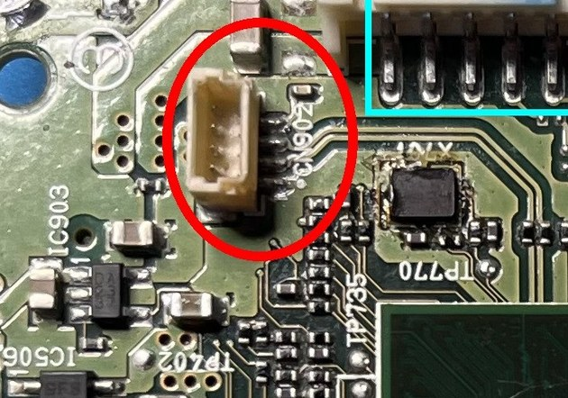
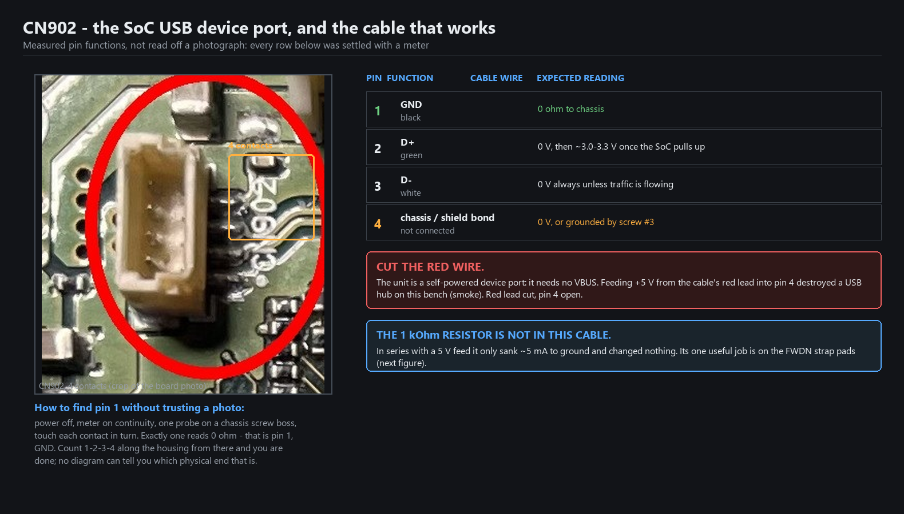
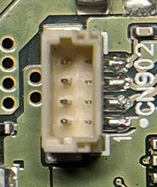

# 08 — CN902: the one port that matters, and the cable that reaches it

Everything in this project — the root shell, the backups, the FWDN session — goes through **one
connector**: CN902, the SoC's USB device port. The unit has three USB-A sockets on its back, and
**none of them can carry this**: they hang off an internal hub chip (IC300) that the SoC's device
port never passes through. If you want adb or FWDN, you open the unit and you wire CN902.

| | |
|---|---|
| what it is | 4-contact, tan, shrouded JST-style SMD header |
| where | top-left board edge of the processor board, ~15 mm from the SoC, beside IC903 and the test-point strip (TP762/763/764/765/768/769/770); silkscreen `CN902` sits immediately right of it |
| reachable with the cover off | yes — and that is the only way |
| carries | adb (`18D1:DEED`), fastboot (`18D1:D00D`), mass storage (`18D1:B058`), FWDN (`140E:B068`) |
| does **not** carry | anything for a UART — it is not a serial port (see [docs/01](01-unit-and-access.md), and the CN102 note at the end of this page) |



*CN902 circled on the processor board, with `CN902` silkscreened immediately right of the housing.
IC903 sits to its left, the TP762–TP770 strip below-left. The shrouded header at the top of the frame
is a different connector — do not probe it by mistake.*



## Pin functions — measured, not read off a photo

Four contacts, and the functions were settled with a meter and a real enumeration, not by guessing
from a photograph:

| pin | function | cable wire | what you should read |
|---|---|---|---|
| 1 | GND | black | 0 Ω to a chassis screw boss |
| 2 | D+ | green | 0 V at power-on, ~3.0–3.3 V a few seconds later (the SoC pulls up when the gadget comes up) |
| 3 | D− | white | 0 V unless traffic is flowing |
| 4 | **chassis / shield bond — and the boot-mode net** | *not connected* | 0 Ω to chassis, **through CN903 and screw #3**; that bond has to be broken for FWDN |

**Find pin 1 with the meter, not by eye.** Powered off, continuity from a chassis screw boss to each
contact in turn: exactly one reads 0 Ω, and that is pin 1. Count 1-2-3-4 along the housing from there.
No photograph can tell you which physical end is pin 1, and getting it wrong puts D+ on D−.



*The housing from above: four contacts in a single row, with `CN902` silkscreened immediately to its
right. The second mark beside each contact is the pin's entry chamfer, not a second row — it is easy
to miscount this one from a photograph, which is exactly why the pin order above came from a meter.*

## Pin 4 is the boot-mode net — and it arrives already grounded

Pin 4 is not just a shield tab. It is the net the SoC samples at reset to decide whether to come up in
boot-ROM (FWDN) mode, and on this unit it is **bonded to chassis ground through two separate paths**:

- **CN903**, the white header on the same board edge, and
- **screw #3**, which ties the shield to the chassis.

Broken it must be, both of them, before FWDN will engage:

| until you break it | what happens |
|---|---|
| CN903 still plugged in | pin 4 stays at chassis ground; pulling it down changes nothing, the unit boots Android |
| screw #3 still fitted | same thing — the shield re-grounds pin 4 through the chassis |
| both open | the pin finally follows what you do to it, and the SoC can be made to enter boot-ROM |

So the FWDN checklist on this board is not "short the pads": it is **unplug CN903, remove screw #3,
then hold pin 4 low at power-up** — and the pads beside TP764 ([docs/09](09-fwdn-mode.md)) are the
other end of the same net if you would rather work there.

This is also the one good reason to use CN902 as the strap point: **pin 4 is reachable with the
heatsink fitted**, while the TP764 pads are under it. The cable itself still does not carry the
signal — you are just borrowing the access.

## The cable

The one that worked here is a **scavenged USB-A charge lead**: cut the small end off, keep the four
flying wires, and land three of them on the connector.

```
USB-A plug  -------------  CN902
 red     VBUS   ---X       (cut, insulated, goes nowhere)
 black   GND    ---------  1  GND
 green   D+     ---------  2  D+
 white   D-     ---------  3  D-
 (none)         ---------  4  left open
```

- **Cut the red wire.** The unit is self-powered: its device port needs no VBUS. Taping the red lead
  back is the difference between a cable and a dead hub — see below.
- **Pin 4 stays open.** It is bonded to the chassis, not a boot strap.
- Contacts are small; 0.2 mm wire or a fine probe tip held with the connector housing as a stop works.
  If you have a mating 4-way plug that fits the housing, use it — but confirm the pin order with the
  meter anyway, in case the plug is a mirror of the header.
- Keep the lead short (under ~1 m) so the high-speed link is not marginal.

### Verification, before you do anything else with it

On a Linux host, plug in and watch the kernel:

```
$ dmesg -w
usb 7-1: new high-speed USB device number 18 using ehci-pci
usb 7-1: New USB device found, idVendor=18d1, idProduct=deed
```

`18D1:DEED` is the AOSP "Android Sooner Composite ADB interface" gadget as this build presents it, and
seeing it proves three things at once: the SoC booted, the kernel's USB stack is alive, and your cable
is correct. On Windows, Device Manager shows the same VID/PID under "Android Device" (or as an unknown
device with that ID, if no Android driver is installed — harmless).

If **nothing** appears: measure pin 2. A steady ~3.3 V there means the SoC is driving D+ and the cable
or the host port is the problem; try a different physical USB port on the PC (Windows latches a port
off after a device drop and will not re-enumerate on it). 0 V on pin 2 means the software side never
pulled up — that is a boot problem, not a cable problem.

One more trap, from this unit: an enumerating device is not the same as a usable one. `adb devices`
can stay empty while the USB link is perfect, because the gadget's interfaces come up with the
firmware, not with the cable. On this unit adb only became reliable after the boot partition was
repaired ([docs/03](03-nand-backup-and-restore.md)) — the cable was already right. Read the USB
descriptor before you reach for the soldering iron.

## The mistake that cost a hub

An earlier version of this rig fed **+5 V into pin 4 through a 1 kΩ resistor**, on the theory that pin
4 was a VBUS/OTG-ID sense contact that selected the boot mode. It was wrong twice over:

- Pin 4 is a **chassis/shield-bond net**. With the resistor fitted it sat there sinking ~5 mA into
  ground and changed nothing at all.
- With the resistor removed, it shorted the host's VBUS rail straight to ground, and **destroyed the
  USB 2.0 hub it was plugged into** (smoke, 2026-11-07).

So: **never** feed 5 V into pin 4, and cut the red wire so you cannot do it by accident. The boot-mode
net is on pin 4 — that is *why* the resistor trick looked plausible — but it is pulled **down**, never
up, and only after CN903 and screw #3 are out (see above). The pads in [docs/09](09-fwdn-mode.md) are
the other end of the same net.

### Where the 1 kΩ resistor actually belongs

It has exactly one job on this unit: **across the two FWDN strap pads as a safe test** before you commit
to a hard short ([docs/09](09-fwdn-mode.md)). If the pads turn out not to be the strap, a 1 kΩ bridge does no harm; a
direct short might. Once the host sees the Telechips device with the resistor in place, you can drop to
a hard short or just keep using the resistor — the SoC samples the pin once, at reset, and a 1 kΩ pull
to ground is normally enough.

## Two things that will waste your time

- **The three USB-A sockets cannot help.** They sit behind the IC300 hub. A boot-ROM device or an
  Android gadget presented on CN902 will never appear on them.
- **CN902 is not a UART**, whatever the shape suggests. A 4-pin header at a board edge is equally
  likely to be a fan or a debug port; here the meter settled it — GND, D+, D−, shield. The 115200 8N1
  experiments on this connector were a dead end. The real console question is separate and also closed
  on this build: the shipped kernel cmdline is `console=null`, so no UART anywhere will print anything
  without a re-signed boot image ([docs/06](06-partitions-and-boot-image.md)).

Next: [docs/09](09-fwdn-mode.md) puts the SoC into boot-ROM mode, [docs/10](10-nand-backup-with-fwdn.md) reads the chip through it.
