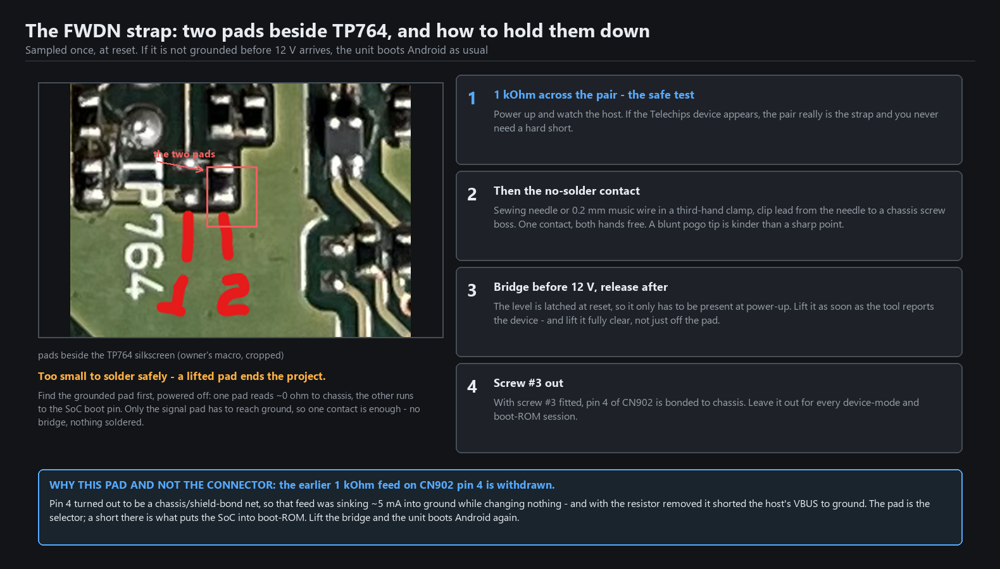
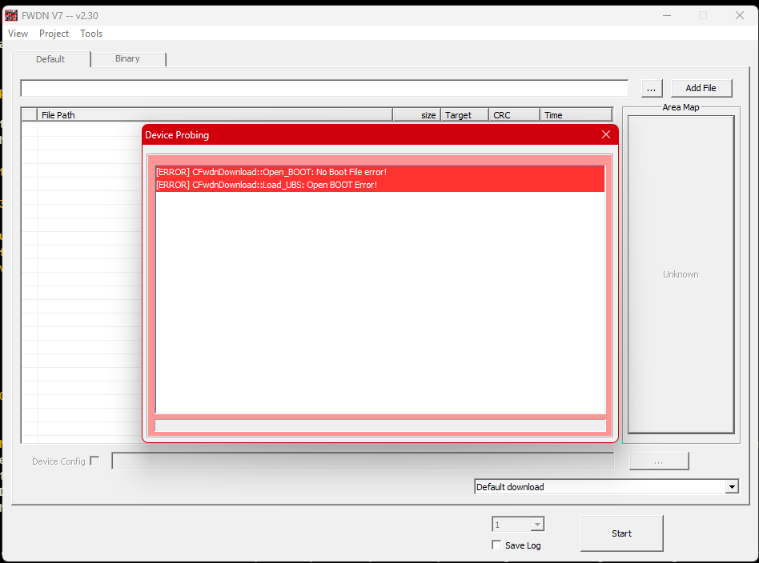
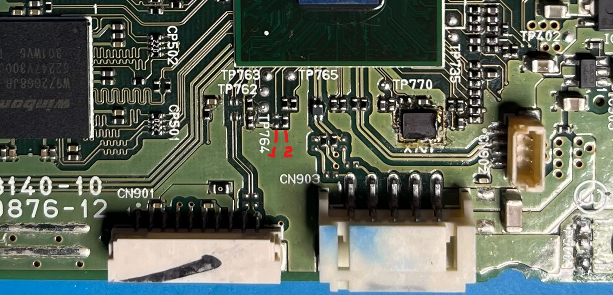
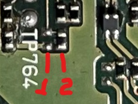
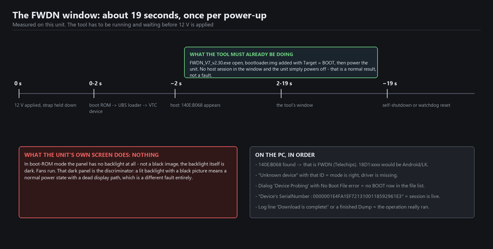
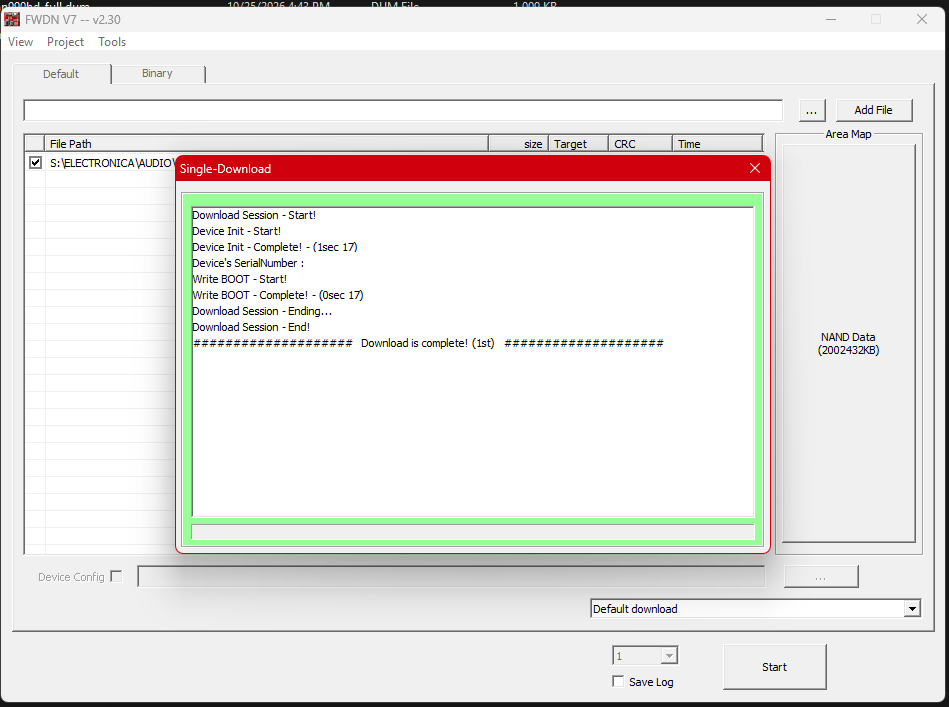
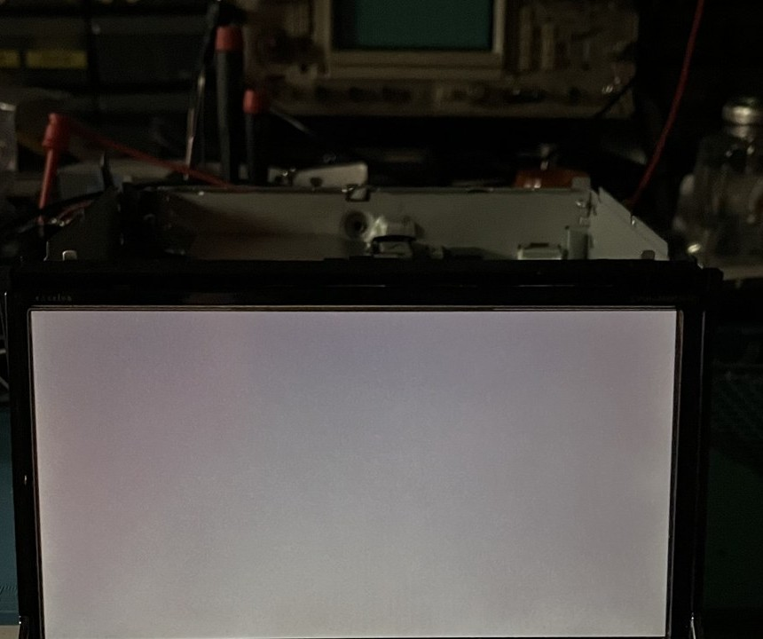

# 09 — Putting the radio into FWDN (boot-ROM) mode

FWDN is Telechips' boot-ROM downloader: a small USB protocol implemented **in the SoC itself**, before
any code from NAND runs. That is why it matters here — with this mode available, a unit whose NAND is
blank, corrupt or half-written can still be reached. Bricking is bounded, not permanent.

Two things have to be true at the same time, and neither is visible on the unit's own screen:

1. the SoC must come up in boot-ROM mode — that is a **pad pair on the board**, shorted at power-up;
2. the PC must already be listening — **driver installed, tool running, waiting**.

Get the order wrong and the unit powers itself off after about 19 seconds and carries on booting
Android. Nothing is damaged; you just did not get a session.



## Part 1 — the PC side (do this first, always)

Windows only; the tool is Win32. Two pieces: a USB driver and the tool.

### The driver

The unit appears on the bus as `140E:B068` and Windows has no inbox driver for it. Without the vendor
driver you get "Unknown device" and the tool's area map stays empty.

The driver is Telechips **VTC Driver v5.0.0.7** (2013, signed). The archive on the bench share is
`Telechips_VTC_Driver_v5.0.0.7.zip`; its password is `DRIVER123` (also in `Password.txt` inside).

Straightforward route — the x64 self-extractor:

```
extract the zip  ->  x64\VTC Driver Installer v5.0.0.7 for x64.exe   ->  run it
```

If Windows refuses it ("untrusted publisher", a 2013 catalog), either boot once through
**Shift+Restart → Troubleshoot → Advanced options → Startup Settings → 7** and run it again, or install
the INF directly. The installer is a self-extracting archive, so the INF can be pulled out of it:

```
7z x "VTC Driver Installer v5.0.0.7 for x64.exe" -oC:\vtcdrv
```

Then, from an **elevated** prompt:

```
pnputil /add-driver C:\vtcdrv\vtcdrv.inf /install
```

Extract to a **local** folder. Pointing Device Manager's *Update driver → Browse* at a network share
fails with "Windows was unable to install your device → cannot find drivers", because the browse branch
never parses a third-party INF from a UNC path.

Proof the driver is the right one: the extracted `vtcdrv.inf` carries the hardware ID

```
%USB\VID_140E&PID_B068.DeviceDesc%="Telechips TCC880x VTC USB Driver"
```

which is exactly what the SoC reports in FWDN mode.

> **Do not delete the device in Device Manager.** Deleting it removes the driver binding and the tool
> will refuse to open the port until you reinstall. Hide ghost entries instead, and power-cycle the radio.

### The tool

`FWDN_V7_v2.30.exe` (v2.13 exists too and works the same way, but every note in this repo is v2.30).
Both ship with the repo under `tools/vendor/`, with checksums, in `tools/vendor/README.md`.

**The tool needs a RAM loader before it can do anything.** FWDN uploads a small bootstrap — the
`BOOT` image — into the SoC's SRAM and runs it; that loader is the code that talks to NAND. With no
`BOOT` row in the file list, probing fails:

```
[ERROR] CFwdnDownload::Open_BOOT: No Boot File error!
[ERROR] CFwdnDownload::Load_LUBS: Open BOOT Error!
```



That is not a hardware fault and not a missing download. The loader is the **stock bootloader** the
vendor update package already carries: `bootloader.img`, 136,928 bytes, the one that begins

```
29 00 00 ea 06 01 ff ff 56 65 72 3a 4c 42 5f 5f    .......Ver:LB__
```

(`Ver:LB__`, `V7 88XX`, `platform/tcc88xx/platform.c`, `SIGBYAHONG_VTC_LINUX_TCC88XX_V2.001`).
In the tool: **Add File** → select `bootloader.img` → confirm the row's **Target** column reads `BOOT`.
Only then will the device probe succeed.

Add the file **before** the unit is powered, along with the tool being open. The 19-second window is
not long enough to do both.

## Part 2 — the strap

The selector is a **pair of pads beside the TP764 silkscreen**, between the TP764 text and the SoC's
test-point pads, just above CN903. Of the two 2-pad footprints side by side, the **left one is bare**
and the right one has a component fitted — the bare pair is the strap.



*The real board: `TP762/763/764/765`, `TP770`, the pad pair under the red `1` / `2` marks, and CN903 —
the white header just below and right of them. CN903 is not scenery: it is half the reason the strap
does nothing until you unplug it.*



*The same pad pair close up. The red `1` / `2` marks were drawn on the photo afterwards — nothing on
the board is labelled, which is why the figure above exists.*

**Before anything else: unplug CN903 and take screw #3 out.** Pin 4 of CN902 is bonded to chassis
ground through both, and while either is in place the boot-mode net never moves — you can hold it down
all day and the unit still boots Android ([docs/08](08-cn902-port-and-cable.md)).

- **You may not need the pads at all.** Pin 4 *is* the accessible end of this net and it sits under no
  heatsink — with CN903 unplugged and screw #3 out, holding pin 4 low at power-up is the easier strap
  and the one to try first.
- **The pads are too small to solder.** A lifted pad ends the project; do not put an iron on them.
- **Find the grounded pad first**, powered off: one pad reads ~0 Ω to chassis, the other runs to the
  SoC's boot pin. Only the signal pad has to reach ground.
- **Use 1 kΩ first.** Bridge the pair with a 1 kΩ resistor and power up. If the Telechips device
  appears, you have the right pair and you never need a hard short.
- **Then a single contact.** A sewing needle or 0.2 mm music wire in a third-hand clamp, with a clip
  lead from the needle to a chassis screw boss: one contact instead of a bridge, and both hands stay
  free for the power switch. A blunt pogo tip is kinder to the pad than a sharp point.
- **The level is latched at reset.** It only has to be present when 12 V arrives; lift it as soon as
  the tool reports the device, and lift it **fully clear** — a stray short elsewhere still lands in
  boot-ROM.

Note that a boot-ROM session used to cost a heatsink lift: the pads are under it. With pin 4 as the
strap point that cost mostly disappears — you still take the cover off, but the heatsink can stay.
Plan the adb work ([docs/03](03-nand-backup-and-restore.md)) in the same open session either way.
A long write with the heatsink off runs with **no thermal sensor anywhere in `/sys`** — plan airflow
rather than watching a temperature that does not exist.

## Part 3 — the sequence

```
1  open FWDN_V7_v2.30.exe
2  Add File -> bootloader.img   (Target column must read BOOT)
3  unplug CN903, take screw #3 out                            (or pin 4 stays grounded)
4  fit the 1 kOhm bridge on pin 4 of CN902 (or on the pad pair)
5  connect the CN902 cable to the PC                       (docs/08)
6  apply 12 V (BATT + ACC + GND)
7  within ~2 s the tool reports the device  --- operate here ---
8  about 19 s after power-up the unit self-shuts down or watchdog-resets
9  lift the bridge; the next power-up boots Android as usual
```



A real session log from this unit, captured in the tool:

```
Download Session - Start!
Device Init - Start!
Device Init - Complete! - (1sec 17)
Device's SerialNumber : <serial>
Write BOOT - Start!
Write BOOT - Complete! - (0sec 17)
Download Session - End!
####################  Download is complete! (1st)  ####################
```



The serial number the log prints on its `Device's SerialNumber` line is the same one `adb devices`
reports for this unit — that is the cross-check that the downloader and Android are the same box. It is
blanked out in the screenshot; yours will be different, and it is enough to identify a radio, so keep
it to yourself.

## What to expect, and what each observation means

**On the unit's screen: nothing.** In boot-ROM mode the panel has **no backlight at all** — not a black
image, the backlight itself stays dark. Fans run. That dark panel is the discriminator: a *lit*
backlight with a black picture is a normal power state with a dead display path, which is a completely
different fault ([docs/02](02-panel-dark-fix.md)).



*What a lit backlight with no picture looks like — backlight on, nothing drawn. This is **not** what
boot-ROM mode looks like; in FWDN the panel is dark because the backlight is off. If you can see this
glow, the strap did not take and the SoC booted from NAND.*

**On the PC**, by USB identity:

| VID:PID | what it is |
|---|---|
| `140E:B068` | **FWDN boot-ROM** — Telechips VTC device. This is the one. |
| `18D1:D00D` | Android fastboot (LK) — the SoC booted to the bootloader |
| `18D1:DEED` | Android gadget, adb configured (`mass_storage,adb`) |
| `18D1:B058` | Android mass-storage gadget |
| `140E:A020` / `140E:A021` | RNDIS |

And by symptom:

| you see | it means | do this |
|---|---|---|
| "Unknown device" / Code 28 with `VID_140E&PID_B068` | **the mode worked**, the driver is missing | install the VTC driver, do not power-cycle the radio |
| `Device Probing` dialog + *No Boot File error!* | no `BOOT` row in the file list | Add File → `bootloader.img` |
| nothing at all, ever | tool started too late, strap not held at reset, or the PC port is latched off | tool first, then strap, then power; move the cable to a different physical USB port |
| device appears, then disconnects ~19 s later | **normal** — no host session inside the window | repeat with the tool already waiting |
| a lit backlight and a black panel | you are **not** in boot-ROM mode | re-check the strap and screw #3 |

## Rules that keep the unit alive

- **Read before you write, every session.** The first session with a new rig is a read only.
- **Never confirm the dialog that reads** *"NAND partition changes is detected. It will erase whole
  NAND."* — that is the bootloader offering to wipe everything because it does not recognise the map.
- **Never press** `Erase`, `Download`, `Low format whole memory before download`, `Total Binary
  Download` or `Update nand.cfg`. Those are not the repair route and they destroy the only copy of the
  partition map.
- **A scoped write is a different act.** Writing N sectors at an explicit `Start Address`, into a region
  whose original content you already hold byte-exact on disk, is the repair route once the read path is
  proven — see [docs/03](03-nand-backup-and-restore.md) and [docs/10](10-nand-backup-with-fwdn.md).
- Nothing here is reversible by the vendor: no public chip image exists for this model. The dump you
  take is the only copy of the MBR and the geometry.

## Menu reality on v2.30

Do not go looking for what is not there:

- The menu bar is `System | View | Project | Tools` — **there is no File menu**.
- `Tools` contains only `Options…`.
- The download-mode combo offers exactly `Default download` and `Low format whole memory before download`.
- The `Binary` tab greys out as soon as the device connects.
- A `Tools → NAND Setting` item exists in the binary but belongs to an unattached `LGE` menu; there is
  no route to it in this build.
- The read path is a **hidden hotkey**: `Ctrl+Shift+D` opens `Storage Dump` (that is [docs/10](10-nand-backup-with-fwdn.md)), and
  `Ctrl+Shift+R` opens `Area Read` (TCC-container images only).

## Getting out

Lift the bridge, remove and re-apply 12 V. With the pad open the SoC boots from NAND as usual. If the
session was left mid-write, the unit may come up with no splash and nothing on screen — that is a
partition-map problem, not a display problem, and it is repaired on this bench with the per-partition
restore in [docs/03](03-nand-backup-and-restore.md).
