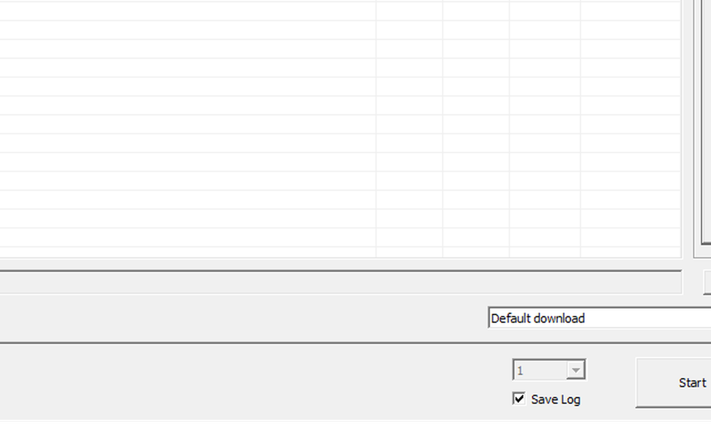

# 10 — Backing up the NAND with FWDN

This is the read-only half of FWDN: dump the chip over the boot-ROM protocol, verify the dump against
the unit's own numbers, and keep it. Do this **before** any write, and do it again if you change
anything structural.

It is also the only backup route when adb is gone — which is exactly the state a half-written unit is in.

## Preconditions

- A working FWDN session: driver installed, tool open, `bootloader.img` in the file list with Target
  `BOOT`, strap fitted at power-up ([docs/09](09-fwdn-mode.md)).
- Somewhere with **2 GB free** on the host. The dump is 1.9 GiB.
- No write commands until the dump verifies.

## The read path is a hidden hotkey

`FWDN_V7_v2.30` has no menu entry for reading the chip. It is compiled in and reachable by an
undocumented accelerator that is not in any menu:

| hotkey | opens |
|---|---|
| **`Ctrl+Shift+D`** | `Storage Dump` — the raw sector read. Fields: `Dump File`, `Name`, `Start Address`, `Size`; buttons `Dump` and `Dump Write`. |
| `Ctrl+Shift+R` | `Area Read` — reads a TCC-container *area image*, not raw sectors. Rejects plain files with "`<file>'s type is unknown.`" |



**Press `Dump`. Never press `Dump Write`** — see the write section at the end.

## Units: sectors, and prove it before you trust it

`Start Address` and `Size` are **512-byte sectors**, and `Name` must carry the area name — with the
field empty the tool returns *Parameter Failure*.

Calibrate with a deliberately small read:

| field | value |
|---|---|
| Name | `NAND Data` |
| Start Address | `00000000` |
| Size | `00000400` |
| Dump File | `C:\fwdn\check_512k.bin` |

`0x400` = 1,024 sectors = **524,288 bytes**. If the file is exactly that size, the unit is sectors. If
it is 1,024 bytes the unit is bytes; if it is 524,288 KB it is KB. Do not attempt the full dump before
this reconciles.

On this unit that calibration dump came out at 524,288 bytes, md5 `6880b361dde2cb1b46a4521b2bcf7c28`,
byte-identical to the same slice of the archival dump — the whole chain (chip → tool → host file) is
byte-exact. **Your unit's first 512 KB will differ** (it carries that unit's own MBR and filesystem);
what transfers is the *method*, not the hash.

## The full dump

| field | value |
|---|---|
| Name | `NAND Data` |
| Start Address | `00000000` |
| Size | **`003D1C00`** |
| Dump File | `dnn990hd_nand_<date>.bin` |

`0x003D1C00` sectors × 512 = **2,050,490,368 bytes** = 1.9 GiB, which is the `NAND Data` area size the
tool itself reports (`NAND Data (2002432 KB)`), and the size of the whole logical address space this
model presents.

Verify the result immediately:

```
> python tools/nand_inspect.py dnn990hd_nand_<date>.bin --boot
size            2050490368  (0x7A380000)
MBR signature   55 AA at 0x1FE
partitions      ndda1..ndda15, starts/sizes reconcile to the image size
ext4            ndda2 /system, ndda3 /data, ndda5 /cache, ndda12, ndda13
boot header     ANDROID! at 16384
```

Then hash it and write the hash down next to the file:

```
> certutil -hashfile dnn990hd_nand_<date>.bin MD5
> certutil -hashfile dnn990hd_nand_<date>.bin SHA256
```

Keep three copies on different media, and keep the `.md5` beside each one. A backup you have not
verified is a hope, not a backup.

## What this dump is, and what it is not

**It is** the logical sector image: MBR, partition table, boot image, every filesystem, exactly as the
bootloader sees them. That is what you need for a per-partition restore.

**It is not a whole-die dump.** Two limits, and both matter:

- `Storage Dump` addresses sectors inside the **`NAND Data` area** only — 2,002,432 KB. The die is
  2,097,152 KB. The ~92.5 MB difference is where the boot areas live, and this dialog cannot reach
  them. (On this unit the bootloader itself is provably *not* in the dump: `bootloader.img`'s signature
  appears zero times in the 2 GB.)
- It carries no spare area, no OOB, no ECC syndrome and no bad-block table. Those need chip-off with a
  programmer, which is a different project with a different risk profile.

So write it down honestly in your notes: *"full logical image, not full physical die."*

## The trap: `Area Read` looks like a dump and is not one

On this bench the first attempt produced `dnn990hd_full.dum`, 1,032,832 bytes, which looked like a
backup and was not. It began with the tool's own container header:

```
000000  5b 48 45 41 44 45 52 5d 60 00 00 00 32 68 8b 38   [HEADER]`...2h.8
000010  46 49 4c 45 53 59 53 54 45 4d 5f 49 4d 41 47 45   FILESYSTEM_IMAGE
000020  54 43 43 20 46 41 54 20 49 4d 47 20 56 30 2e 31   TCC FAT IMG V0.1
00003a  4e 41 4e 44 20 44 61 74 61 00                     NAND Data
```

…and the session log from the same run said `Write BOOT - Complete!`, not a read at all. Two lessons
that generalise to any vendor flasher:

- **Check the first 64 bytes of the file** against what you asked for. `ANDROID!` or an `55 AA` MBR at
  offset 0 means sectors. `[HEADER]` means a container.
- **Read the session log, not just the absence of an error.** "Download is complete" is a *write*
  result. A dump announces itself as `TOTALDUMP_BlockReadCmd` / `Dump Read`.

## Writing — and why this page does not tell you to

`Dump Write` is present in the same dialog and **does not work on this build**: it issues
`TOTALDUMP_BlockWriteCmd` and then waits forever for `TOTALDUMP_BlockWriteRsp`. Two attempts, two
wedged radios, each recovered by a power cycle. Do not use it.

The write path that does work is the **file-list route** (`Add File` → Target `NAND Data` → `Start`),
which accepts only Telechips containers and validates by content, not by extension — a raw file gives
`Error! - Not supported file`. Building such a container by hand is covered in
`tools/vendor/README.md` and in the bench notes; it is a deliberate, scoped act.

Every write in this project went through adb ([docs/03](03-nand-backup-and-restore.md)), where each partition could be written with a
sector address you could read back immediately. That is the recommended route whenever the unit still
gives you a shell. FWDN remains the route of last resort, and the rules there are absolute:

- never `Erase`, never `Download`, never `Low format whole memory before download`;
- never `Total Binary Download`, never `Update nand.cfg`;
- **never** confirm *"NAND partition changes is detected. It will erase whole NAND."*;
- no write into a sector range whose original content you do not already hold on disk.

## Related

- [docs/03](03-nand-backup-and-restore.md) — the adb-side backup and the per-partition restore, which is what actually repaired this unit.
- [docs/09](09-fwdn-mode.md) — getting into FWDN at all.
- `tools/nand_inspect.py` — verifies a dump: size, MBR, the 15 partitions, ext4 superblocks, boot header.

One write is legitimate and this page deliberately does not perform it: restoring the 32-sector
partition map when an area write has destroyed it. That container is rebuilt, not downloaded — see
[docs/12](12-rebuilding-the-partition-map.md).
